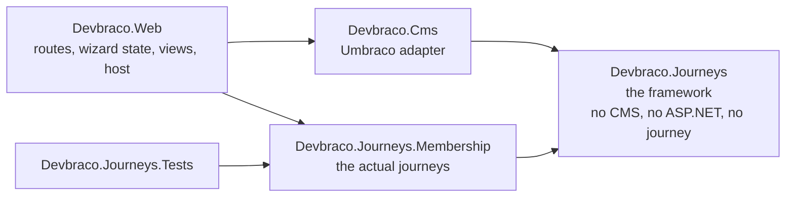
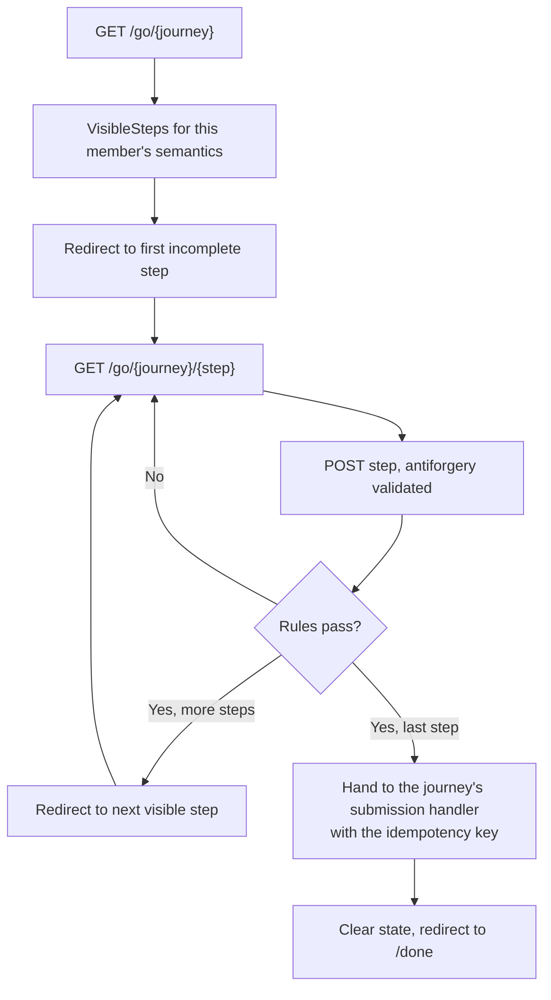

# Devbraco implementation

How the code is put together, why it is put together that way, and what to do when you need to change it.
The business framing is in [OBJECTIVE.md](OBJECTIVE.md).

Everything described as *built* is in the repository today and covered by tests. Everything described as
*planned* has a named home but no code yet.

## Projects and the dependency rule



| Project | Contains | May reference |
| --- | --- | --- |
| [src/Devbraco.Journeys](src/Devbraco.Journeys) | **The framework.** Field and layout model, validation rules, declarative conditions, flow resolution, layout validator, copy and submission contracts | Nothing but the base class library |
| [src/Devbraco.Journeys.Membership](src/Devbraco.Journeys.Membership) | **The journeys.** The renewal journey, its API mapping, its submission handler, and the catalogue naming which journeys this deployment runs | `Devbraco.Journeys` |
| [src/Devbraco.Cms](src/Devbraco.Cms) | The Umbraco adapter: content type bootstrap, structure guard, copy provider | `Devbraco.Journeys`, Umbraco |
| [src/Devbraco.Web](src/Devbraco.Web) | MVC routes, wizard state, views, dev sign-in, API stub, Umbraco host, and the registrations that choose a journey catalogue | All of the above |
| [tests/Devbraco.Journeys.Tests](tests/Devbraco.Journeys.Tests) | Framework tests against fixture journeys, renewal journey tests, architecture tests | `Devbraco.Journeys.Membership` |

**The framework and the journeys are separate projects on purpose.** A journey is a small, readable
declaration; the machinery that runs it is somewhere else and nobody needs to read it to add a question.
It also makes the dependency direction a compile-time fact rather than a convention: the framework cannot
reference a journey, so it cannot grow knowledge of one.

The two arrows that matter are the ones that do not exist, and both are asserted rather than hoped for in
[ArchitectureTests.cs](tests/Devbraco.Journeys.Tests/ArchitectureTests.cs):

```28:32:tests/Devbraco.Journeys.Tests/ArchitectureTests.cs
    public void The_framework_does_not_reference_any_journey()
    {
        Assert.DoesNotContain(References(Framework), name =>
            name.StartsWith("Devbraco.Journeys.", StringComparison.Ordinal));
    }
```

The other is that neither the framework nor the journeys reference Umbraco. That is the
platform-independence seam. Journeys know wording comes from an `IJourneyCopyProvider`; they do not know
that a CMS exists. Moving to a different CMS means reimplementing three files —
[CmsJourneyCopyProvider.cs](src/Devbraco.Cms/CmsJourneyCopyProvider.cs),
[JourneyContentBootstrap.cs](src/Devbraco.Cms/JourneyContentBootstrap.cs) and
[JourneyStructureGuard.cs](src/Devbraco.Cms/JourneyStructureGuard.cs) — and not touching a single journey.
The same seam means rendering could move off Razor without the journeys noticing, because
`JourneyFlow.VisibleSteps` returns data, not markup.

Two small contracts in the framework keep the host out of the journeys' business:

- `IJourneyCatalog` names the journeys a deployment runs. Nothing resolves a journey any other way, so
  Phase 1 can hand a client profile a different catalogue without touching the controller or the CMS
  adapter.
- `IJourneySubmissionHandler` sends a completed journey somewhere, one implementation per journey slug.
  Mapping answers onto an API contract lives with the journey that owns the contract, which is why the
  generic controller no longer names a mapper or a renewals client.

Both are registered by the host in [JourneyWebComposer.cs](src/Devbraco.Web/JourneyWebComposer.cs). That
registration is the only place in the codebase that says this deployment runs membership journeys.

## The five locked invariants

These were each a contradiction found during design review. They are settled, and changing one is an
architecture decision rather than a refactor.

**1. Copy is stored flat and keyed, never nested inside steps.** One copy node per copy key, looked up by
key. Step nodes hold only a title and intro, keyed by step slug. Nesting field wording inside step blocks
would orphan a client's customised label the moment a layout changed, which defeats the point of layout
being configurable. Enforced by the node structure in `JourneyContentBootstrap.EnsureContent` and the key
index in `CmsJourneyCopyProvider.Load`.

**2. The desired value is composed before any merge: `compose(code default, client override)`.** The
presence of a client override entry is what makes it stick, because the override *becomes* the desired
value, so a later change to the shared default cannot replace it. Deleting the entry is how a client is
deliberately returned to the shared default. A `force` flag has nothing to do with stickiness; its only job
is overwriting a value the client has since edited themselves. Phase 2 work; the Phase 0 bootstrap creates
and never updates, which is the conservative end of the same rule.

**3. The layout validator runs against the capability-filtered catalogue.** Every field in the *effective*
catalogue appears exactly once in the layout. Omitting an optional field is expressed as a capability being
off, never as a gap in the layout, and a layout referencing a capability-disabled field is an error rather
than a silent no-op. Enforced by the `effectiveFieldKeys` parameter of
[LayoutValidator.Validate](src/Devbraco.Journeys/LayoutValidator.cs).

**4. Blank copy means inherit; only structural properties are guarded.** Copy keys, step slugs and journey
slugs are locked. Label, help text, placeholder and validation message may all be blank, and blank resolves
to the code default *at read time* rather than being snapshotted, so clearing a field is how a client
reverts, and a blanked value then tracks future changes to that default automatically. The save guard
therefore cancels only on structural violations, never on empty copy.

**5. A field the mapper always sends is never conditionally hidden.** Such a field must have an
`IncludeWhen` that is true for every semantic combination a client profile can produce. Any field that can
be hidden is optional in the API contract and is tested both present and absent. This is why `IncludeWhen`
is a declarative condition rather than an opaque lambda: it has to be analysable. Enforced by
`RenewalJourney.AlwaysSent` plus the `Always_sent_fields_are_never_conditional` test.

## Defining a journey

A journey is one class implementing `IJourneyDefinition`, with two deliberately separate parts.

**The field catalogue** is a flat list of `FieldDefinition`. Each field carries its key, type, copy key,
code-default wording, a `Sensitive` flag, its `IncludeWhen` condition and its validation rules.

**The step layout** is a separate `StepLayout` that references field keys. Nothing about a field knows
which step it lives on. This split is what makes "two steps of five questions" versus "five steps of two"
a configuration change rather than a code change, and it is why copy keys are layout-independent: moving a
field between steps cannot lose a client's customised label.

[RenewalJourney.cs](src/Devbraco.Journeys.Membership/RenewalJourney.cs) is the worked example, and the
whole of it is fifty lines. Four fields, one of which is conditional:

```38:49:src/Devbraco.Journeys.Membership/RenewalJourney.cs
        new FieldDefinition("lapseReason", FieldType.Text)
        {
            CopyKey = "renewal.field.lapseReason",
            DefaultLabel = "Why did the membership lapse?",
            IncludeWhen = When.Semantic(MemberSemantic.IsLapsed),
            Rules = [Rule.Required(), Rule.MaxLength(200)]
        }
    ];

    public StepLayout Layout { get; } = StepLayout.From(
        ("your-details", "renewal.step.your-details", "Your details", "Tell us how to reach you.", ["email", "dateOfBirth", "membershipNumber"]),
        ("circumstances", "renewal.step.circumstances", "Your membership", null, ["lapseReason"]));
```

`AlwaysSent` names the three fields the API contract requires unconditionally, which is invariant 5 made
testable. `lapseReason` is the only field that may be absent, so it is the only nullable property on
`RenewalSubmission`, and [RenewalMapper](src/Devbraco.Journeys.Membership/RenewalMapper.cs) re-evaluates
the same `IncludeWhen` rather than trusting whatever happens to be in the answer dictionary — a stale
answer from before a member's state changed must not reach the API.

Payment is not collected in this journey, and that is a design constraint rather than an omission. Card
data never enters the field catalogue, which is how PCI DSS scope stays out of this application. Payment
stays tokenised elsewhere.

`StepLayout.From` computes a twelve-character hash of the slug-and-field-key structure as `Version`. It is
stamped onto wizard state so a layout change mid-session is detectable.

## Conditions are declarative, so the layout can be checked

`When` is an abstract class with three constructors — `When.Always`, `When.Semantic(...)`,
`When.AnswerIs(...)` — and it exposes `IsAlways` and `DependsOn` alongside `Evaluate`. The whole point is
that a condition can be *read* rather than only run.

[LayoutValidator](src/Devbraco.Journeys/LayoutValidator.cs) uses that to reject, at test time, every class
of layout mistake that repagination can introduce:

- a step referencing a field that is not in the catalogue;
- a field appearing in more than one step;
- an effective field missing from the layout entirely;
- a step referencing a field this client's capabilities omit (invariant 3: a capability problem reported as
  a capability problem);
- **a field whose condition depends on an answer collected in a later step**, which is the mistake nobody
  spots by eye and which produces a permanently invisible question in production.

That last one has its own test with a deliberately broken fixture journey:

```42:47:tests/Devbraco.Journeys.Tests/FrameworkTests.cs
    [Fact]
    public void A_field_that_depends_on_a_later_answer_is_rejected()
    {
        var errors = LayoutValidator.Validate(new BrokenJourney());
        Assert.Contains(errors, error => error.Contains("later step", StringComparison.Ordinal));
    }
```

Lambdas would have made all of this unavailable. That is the trade: conditions are less expressive than
arbitrary code, and in exchange a per-client layout can be proved sound before anyone deploys it.

## Member state: semantics, not statuses

`MemberSemantic` is the fixed set of meanings journey logic is allowed to branch on: `IsActive`,
`IsPending`, `IsLapsed`, `CanRenew`, `RequiresPaymentPrompt`. `JourneyContext` carries the current member's
resolved semantics plus the answers so far, and that is the only thing `When.Evaluate` receives.

No journey ever sees a client's raw status string. Phase 1 adds the per-client mapping from raw values onto
semantics, loaded from a profile, with an unknown value degrading and alerting rather than throwing. Phase 0
supplies semantics from the development sign-in instead, which is enough to exercise every conditional path.

If you need a new meaning, add it to the enum and expect to map it in every client profile before merge.
That friction is intentional: it forces the twenty-client conversation at pull request time rather than at
deploy time.

## Copy resolution

Code defaults live next to the field they belong to, so they are type-checked, reviewable as an ordinary
diff, and usable as a runtime fallback. `CopyText.Resolve` is the whole of invariant 4:

```5:9:src/Devbraco.Journeys/CopyText.cs
    /// <summary>
    /// Blank CMS copy means inherit the code default, resolved at read time.
    /// </summary>
    public static string Resolve(string? cmsValue, string codeDefault) =>
        string.IsNullOrWhiteSpace(cmsValue) ? codeDefault : cmsValue;
```

`CmsJourneyCopyProvider` implements the same rule against the published content cache, building a key index
once per request and looking copy up by `StableGuid.For(copyKey)` — a deterministic GUID derived from the
copy key, which is what lets code and content agree on node identity without storing a mapping table.

Every fallback is recorded on `ICopyTrace`, and the development toolbar renders the keys that fell back. In
practice this answers most "why does this say the wrong thing" questions at a glance.

The consequence worth internalising: **the site is fully functional before any CMS content exists.** Copy
resolution degrades to code defaults, so content bootstrap is never on the critical path for the site to
work, only for clients to see their own wording.

## The Umbraco adapter

**`JourneyContentBootstrap`** handles `UmbracoApplicationStartedNotification` and, inside one core scope,
ensures four document types exist (`journeysRoot`, `journey`, `copyEntry`, `stepCopy`) and then ensures a
content node exists for the root, each journey, each step and each field.

Two properties of this are load-bearing:

- **It is create-only.** `EnsureNode` returns immediately if a node with that key already exists. Nothing
  the pipeline does can damage client content, which is the entire reason Phase 0 ships without the merge.
- **The document types are generic containers.** A journey node holds a slug and a title; a copy entry holds
  a key and four wording properties. Adding a journey, a step or a field therefore creates *content*, never
  schema. The smell test for the whole architecture: if adding a journey produces a schema diff, you have
  left the architecture.

**`JourneyStructureGuard`** handles `ContentSavingNotification` and `ContentDeletingNotification`. It
cancels a save that changes `copyKey`, `stepSlug` or `journeySlug` on a managed node, and cancels deletion
of a managed node outright. It checks `IsPropertyDirty` and compares against the published value, so a
no-op save is not rejected, and it says nothing about blank wording — blank is a legitimate client action
meaning "inherit".

Both are registered in [JourneyComposer.cs](src/Devbraco.Cms/JourneyComposer.cs), along with scoped
`ICopyTrace` and `IJourneyCopyProvider`.

One rule to carry into Phase 1 when uSync arrives: **reconciler-owned content is never uSync-owned
content.** The Journeys tree must be excluded from the content handler with `RulesOnExport` set, or the
bootstrap's own writes get exported and committed as content, creating a second source of truth that fights
the code defaults.

## Wizard runtime



[JourneyController](src/Devbraco.Web/Journeys/JourneyController.cs) is plain MVC with attribute routes, and
it is entirely generic: it resolves the journey through `IJourneyCatalog` and hands the finished answers to
the `IJourneySubmissionHandler` whose slug matches. It names no journey and no API. Worth knowing:

- **Steps are resolved per request**, not stored. If a member's semantics change mid-journey, the visible
  step list changes with them, and `JourneyFlow.VisibleSteps` drops any step whose fields all resolve
  hidden rather than rendering an empty page.
- **Forward navigation is guarded** by `JourneyFlow.FirstIncompleteIndex`, so a hand-typed URL for step
  three redirects back to the first step that does not validate. Backward navigation is free.
- **Post-redirect-get throughout**, with `[ValidateAntiForgeryToken]` on the post.
- **An idempotency key is minted at journey start** and sent with the final submission, so a double submit
  or a retry cannot create two renewals.
- **Validation messages go through the copy provider**, so a client can reword "This field is required"
  without touching the rule that produced it.

The views in [src/Devbraco.Web/Views/Journey](src/Devbraco.Web/Views/Journey) are a single generic renderer
keyed by `FieldType`. There is no per-journey view, and adding one would be a regression.

## Personal data

Wizard answers are personal data, so [WizardStateStore](src/Devbraco.Web/Journeys/WizardStateStore.cs)
treats them as such:

- The serialised state is encrypted with ASP.NET Core Data Protection under the purpose
  `Devbraco.WizardState.v1` before it reaches the distributed cache. The cache itself is plaintext storage,
  so the blob has to arrive already protected.
- Thirty-minute sliding expiry, two-hour hard lifetime enforced on both read and write.
- The session identifier lives in an `HttpOnly`, `SameSite=Lax` cookie, `Secure` over HTTPS.
- State is deleted on successful submission, and a blob that fails to decrypt or deserialise is discarded
  with a warning rather than throwing.
- Answers are never logged. Log lines carry the journey slug only. Fields holding personal data are marked
  `Sensitive` in the catalogue so the renderer can suppress autofill and so future audit tooling has
  something to key on.
- Card data is out of scope by design, as above.

In production the distributed cache becomes the SQL Server cache table rather than memory: every client
already has a database, and twenty Redis instances is real money for modest session volumes.

## Running it locally

```bash
dotnet run --project src/Devbraco.Web
```

A cold clone boots to a working site with no installer wizard and no backoffice clicking, because
`appsettings.Development.json` is committed with SQLite plus unattended install. Then:

- The journey is at `/go/renewal`.
- The backoffice, which you do not need, is `dev@local.test` / `Local-dev-only-1`.
- `/dev/member?semantics=IsLapsed,RequiresPaymentPrompt` signs you in as a fake member with those
  semantics, so testing the lapsed path is a querystring change rather than an identity-provider exercise.
  Development only; the endpoint returns 404 otherwise.
- `/dev/api/renewals` is the local API stub, also Development only, so completing a journey needs no VPN,
  no credentials and no client's cooperation.
- The development toolbar on each step shows the active semantics and any copy keys that fell back to code
  defaults.

Two environment facts that save debugging time: Razor views hot reload but journey definitions do not, so a
catalogue change needs a restart; and Models Builder runs as `SourceCodeManual` locally with models
committed, while deployed environments use `ModelsMode: Nothing` with `Runtime:Mode: Production`, which
Umbraco's own validators enforce.

```bash
dotnet test
```

Twenty-two tests in three groups, which mirror the project split:

- [FrameworkTests.cs](tests/Devbraco.Journeys.Tests/FrameworkTests.cs) exercises flow resolution and every
  layout validator failure mode against fixture journeys. No real journey appears in it, which is the
  point: the framework does not know what we happen to be building with it.
- [RenewalJourneyTests.cs](tests/Devbraco.Journeys.Tests/RenewalJourneyTests.cs) covers the shipped
  journey: its layout is valid, the catalogue finds it by slug, a lapsed member gets the extra step, the
  always-sent fields are unconditional, and the mapper omits the conditional answer unless it applies.
- [ArchitectureTests.cs](tests/Devbraco.Journeys.Tests/ArchitectureTests.cs) holds the dependency rules and
  asserts every journey in the catalogue has a valid layout, so a broken layout cannot ship.

Plus [CopyAndRulesTests.cs](tests/Devbraco.Journeys.Tests/CopyAndRulesTests.cs) for blank-means-inherit and
each validation rule.

## Recipes

Each of these is a code-only change. None of them requires opening the backoffice, and none of them
produces a schema diff.

**Add a field to an existing step.** Add a `FieldDefinition` to the journey's catalogue with its copy key,
default wording and rules. Add its key to the relevant step's `FieldKeys`. Add it to the mapper and, if the
API always expects it, to `AlwaysSent`. Run the tests: the layout validator will tell you if you missed the
layout entry. The copy node appears on next boot.

**Repaginate.** Change only the `StepLayout.From` call. Field definitions and copy keys do not move, so no
client's customised wording is affected, and the layout `Version` changes so in-flight sessions are
detectable. The validator re-checks dependency ordering for you.

**Add a whole new journey.** A class implementing `IJourneyDefinition`, added to the catalogue in
[MembershipJourneys.cs](src/Devbraco.Journeys.Membership/MembershipJourneys.cs), plus an
`IJourneySubmissionHandler` registered in the host. Three files, all in the journeys project. The routes,
renderer, state handling, copy nodes and structure guard all apply automatically, and `ArchitectureTests`
validates the new layout the moment it joins the catalogue. If this step ever requires a change to the
framework or to the CMS, something has gone wrong.

**Add a validation rule.** New nested class in [Rule.cs](src/Devbraco.Journeys/Rule.cs) with a `Code`, a
`DefaultMessage` and `TryValidate`. Note the existing convention: rules other than `Required` pass on an
empty value, so emptiness is `Required`'s business alone and messages do not stack.

**Add a field type.** Add the enum value and a branch in the generic renderer. Resist the urge to add a
per-journey view.

**Make a field conditional.** Give it an `IncludeWhen`, confirm it is not in `AlwaysSent`, make the mapper
property nullable, and test the journey with the field both present and absent. If the condition is
`When.AnswerIs`, the validator will enforce that the field it depends on is collected earlier.

## What Phase 0 deliberately leaves out

| Not built | Where it goes |
| --- | --- |
| Per-client profiles, vocabulary mapping, capability flags | Phase 1. `LayoutValidator` already takes the effective field set, `JourneyContext` already carries semantics, and `IJourneyCatalog` is already the only way a journey is resolved |
| uSync for schema and seeded content, folder layering per client | Phase 1, with the Journeys tree excluded from the content handler |
| Provenance-aware three-way merge of our defaults against client edits | Phase 2, report-only first. Today's bootstrap is the create-only end of the same rule |
| Release rings, per-client change manifests, divergence reports | Phase 1 and 2 |
| Draft copy preview inside the wizard | Later objective. Cheap when it comes, because copy resolution goes through one provider, so preview is a resolution mode rather than a rendering path |
| Zero-downtime releases | Deliberately traded away. Requirements recorded so the decision can be reversed knowingly |
| Real identity provider, real API client, resilience policies | Phase 1. Auth must use a separate scheme and cookie name from the Umbraco backoffice, which is the most common way these builds break |
| Architecture tests banning client-specific conditionals | Phase 1, and they are the load-bearing guardrail against gradual re-forking rather than anything written here |
