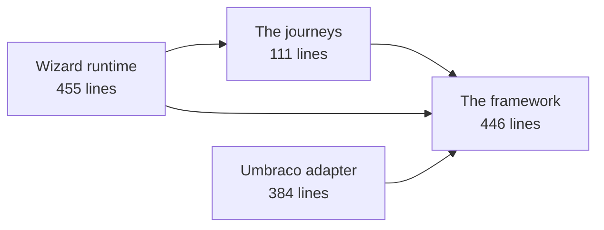

# Phase 0: what exists today

A walkthrough of the working slice, for the CTPO and architects. Less detail than
[IMPLEMENTATION.md](IMPLEMENTATION.md), more than [OBJECTIVE.md](OBJECTIVE.md).

The short version: there is a running multi-step journey, driven by one shared codebase, with wording
editable in a CMS and no client-specific code anywhere. It is about 1,400 lines of application code. A
developer clones the repository, runs one command, and completes a journey in the browser without
installing a database, configuring a CMS or talking to anyone.

The point of this document is that the architecture is smaller than it sounds.

## The shape of it

Five parts, each with one job. The sizes are real, and they are the reassuring part.



| Part | What it does | Size |
| --- | --- | --- |
| The framework | Describes what a question, a rule, a condition and a step are. Resolves which steps a given member sees. Validates that a layout is sound | 446 lines, 15 files |
| The journeys | The actual renewal journey: its questions, its wording defaults, its rules, and how its answers map onto the API | 111 lines, 4 files |
| The wizard runtime | Routes, server-side state, validation on post, the generic renderer, development sign-in | 455 lines, 5 files |
| The Umbraco adapter | Creates the wording nodes on first run, stops clients breaking structure, reads wording back out | 384 lines, 4 files |
| The tests | Framework behaviour, journey behaviour, and the dependency rules | 258 lines, 22 tests |

The journeys and the framework are separate projects, and the framework physically cannot reference a
journey. That is enforced by a test, not a convention. It means the thing a developer reads and edits to
change the product is 111 lines, and the machinery behind it can be ignored.

## What a journey actually is

This is the entire definition of a conditional question, including its wording defaults, its validation and
the rule that it only appears for a lapsed member:

```csharp
new FieldDefinition("lapseReason", FieldType.Text)
{
    CopyKey = "renewal.field.lapseReason",
    DefaultLabel = "Why did the membership lapse?",
    IncludeWhen = When.Semantic(MemberSemantic.IsLapsed),
    Rules = [Rule.Required(), Rule.MaxLength(200)]
}
```

And this is the entire pagination of the journey — which questions appear on which step, in which order:

```csharp
public StepLayout Layout { get; } = StepLayout.From(
    ("your-details",  "renewal.step.your-details", "Your details",   "Tell us how to reach you.", ["email", "dateOfBirth", "membershipNumber"]),
    ("circumstances", "renewal.step.circumstances", "Your membership", null,                      ["lapseReason"]));
```

Two things follow from the fact that these are separate. Repaginating a journey — two steps of five
questions instead of five steps of two — touches only the second block, so it is configuration rather than
development. And because a question's wording is keyed by the question rather than by its position, moving
a question between steps cannot lose a client's customised label.

The condition on the question is a declared value rather than arbitrary code, which is what lets us check
layouts mechanically. The tooling already rejects a layout where a question is conditional on an answer the
member has not been asked for yet, which is the repagination bug nobody catches by eye.

## What we deliberately did not build

This is the part that usually makes these architectures frightening, so it is worth being explicit about
what is absent:

- **No forked repositories.** One codebase. There is no per-client branch, no per-client build, and no
  client name anywhere in the code.
- **No code generation and no DSL.** Journeys are ordinary C# classes. They are read, reviewed and debugged
  like any other code.
- **No workflow or rules engine.** Conditions are a fixed, tiny vocabulary, deliberately not
  Turing-complete.
- **No bespoke CMS development.** No custom property editors, no custom dashboards, no backoffice plugins.
  Umbraco is used as supplied.
- **No CMS configuration to add a journey.** The document types are generic containers, so a new journey,
  step or question creates content, never schema. If adding a journey ever produces a schema change,
  someone has left the architecture.
- **No client-editable logic.** Clients edit wording. They cannot change validation, structure, order or
  conditions, and the application rejects attempts to change structural keys.
- **No requirement for clients to use the backoffice at all.** Everything works from code defaults; the CMS
  only ever overrides.

## What Phase 0 proves

Each of these was a question we could have argued about indefinitely. They are now settled by something
running.

| Claim | Evidence |
| --- | --- |
| A journey is a code-only change | The renewal journey exists in 4 files; no CMS configuration was performed to create it |
| Adding client control of wording does not put the CMS on the critical path | Wording resolves to code defaults when the CMS has no value, so the site works fully before any content exists |
| Clients can clear wording to revert | Blank means inherit, resolved at read time, so a cleared value tracks future improvements to the default |
| Clients cannot break the application | Attempts to change a copy key, step slug or journey slug, or to delete a managed node, are cancelled with an error |
| Our releases cannot damage client content | The bootstrap creates what is missing and never overwrites an existing node |
| Member state drives the journey without client-specific code | A lapsed member is shown "Step 2 of 2" and an extra question; an active member sees one step. Same build, same code |
| The conditional answer never leaks into the API | The mapper re-evaluates the condition and omits the answer for an active member, verified by test |
| Personal data is handled properly | Answers are encrypted in server state, expire within two hours, are deleted on submission, and appear nowhere in the logs |
| Card data is out of scope by construction | Payment is not a question in the catalogue, so PCI scope stays out of this application |
| The CMS is replaceable | The framework and journeys have no reference to Umbraco; both facts are asserted by tests |

Verified on the current build by walking the journey end to end: sign in as a lapsed member, land on step
one of two, post an empty form and get three "This field is required" messages, complete both steps, and
receive confirmation reference `376a28ba4acd`. The four values submitted — email address, date of birth,
membership number and free-text reason — appear nowhere in the application log. Twenty-two tests pass.

## What a change costs

This is the table to argue with, because it is the whole commercial case.

| Request | What it takes | Who does it |
| --- | --- | --- |
| Change wording, help text, an error message | Edit in the CMS, publish | The client, unaided |
| Reorder or repaginate steps | One block of configuration, validated automatically | Us, no bespoke work |
| Add or remove an optional question for one client | A capability flag in that client's profile | Us, configuration only |
| Add a question for everyone | Three small edits in the journeys project | Us, one release for all clients |
| A different version of a journey for one client | A second journey class in the shared codebase | Us, no fork |
| A new client | A configuration profile and a database | Automated in Phase 3 |
| A client changes their member statuses | A mapping entry in configuration | Us, no build of application logic |

The last row is the one that matters most, because it is the case that currently requires compiled code in
a client's own repository.

## What is not there yet

Phase 0 was kept deliberately small, so the honest list of absences is long and each item has a home:

- Per-client configuration profiles, the status vocabulary mapping and capability flags. The seams exist:
  journey logic already branches only on canonical meanings, and journeys are already resolved through a
  catalogue the host chooses. Phase 1.
- Pushing improved wording defaults out to clients who have not customised it. Today a release creates
  missing wording and touches nothing else. Phase 2, starting in report-only mode. This is the one piece of
  genuinely bespoke infrastructure in the plan and the one we are deliberately slow about.
- Release rings, per-client change manifests, synthetic monitoring. Phases 1 and 3.
- Real identity provider and real API client, with retry and circuit breaking. Phase 1.
- Preview of unpublished wording inside the wizard. Wanted, not scheduled, and cheap when it comes because
  all wording goes through one provider.
- Zero-downtime releases. Deliberately traded for a short scheduled restart per client; the requirements to
  reverse that decision are written down.
